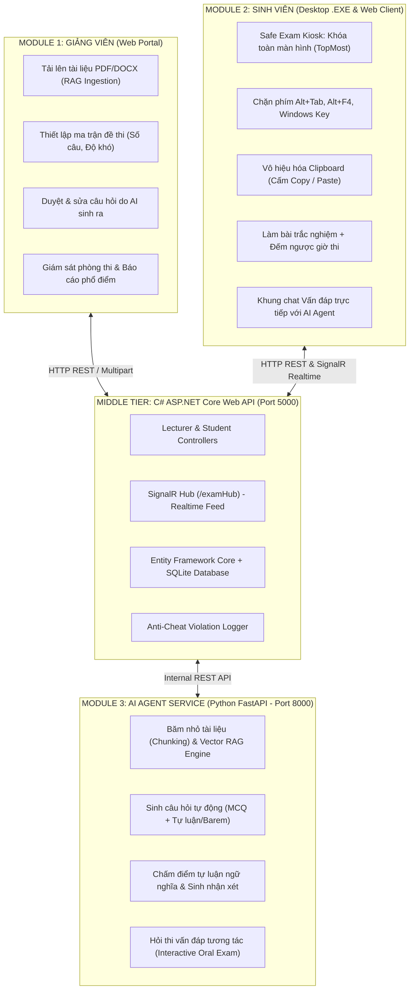

# HỆ THỐNG PHẦN MỀM QUẢN LÝ VÀ AI AGENT HỖ TRỢ KIỂM TRA ĐÁNH GIÁ SINH VIÊN
## ĐỀ TÀI NGHIÊN CỨU KHOA HỌC SINH VIÊN — ĐẠI HỌC CÔNG NGHỆ THÔNG TIN & TRUYỀN THÔNG (ICTU)

---

### 1. Tổng Quan Kiến Trúc Hệ Thống (3 Phân Hệ Cốt Lõi)

Dự án được tái cấu trúc từ nền tảng DevExpress XAF cồng kềnh sang **kiến trúc vi dịch vụ module hóa (Modern Decoupled Architecture)**:



---

### 2. Chi Tiết Kỹ Thuật 3 Module

#### Module 1: Quản Lý Dành Cho Giảng Viên (Lecturer Web Portal)
- **Nền tảng**: HTML5 / TailwindCSS / JavaScript ES6 + C# ASP.NET Core Web API.
- **Tính năng**:
  - Tải lên tài liệu học thuật (PDF, Word, TXT) -> nạp tự động sang Module 3.
  - Cấu hình ma trận đề: Số lượng câu trắc nghiệm, câu tự luận, độ khó (Nhận biết, Thông hiểu, Vận dụng).
  - Màn hình duyệt, chỉnh sửa câu hỏi do AI Agent sinh ra trước khi lưu vào Ngân hàng đề thi.
  - Bảng điều khiển giám sát trực tiếp (Realtime Live Monitoring): Nhận cảnh báo vi phạm gian lận tức thời qua SignalR.
  - Báo cáo phân tích phổ điểm, tỷ lệ sinh viên đạt chuẩn đầu ra và tổng hợp nhận xét của AI.

#### Module 2: Quản Lý Tiến Độ & Thi Cử Dành Cho Sinh Viên (Student Safe Exam)
- **Nền tảng**:
  1. **Ứng dụng Native Desktop C# WinForms (.EXE)**: Chạy trên máy trạm phòng máy.
  2. **Cổng Web Thi An Toàn (Web Client)**: Hỗ trợ thi trực tuyến trên trình duyệt.
- **Cơ chế Chống Gian Lận (Anti-Cheat Engine)**:
  - Khóa toàn màn hình (Kiosk mode, `TopMost = true`, loại bỏ thanh tiêu đề).
  - Chặn phím tắt chuyển tab (Alt+Tab), phím Windows, phím đóng ứng dụng (Alt+F4).
  - Vô hiệu hóa tính năng sao chép và dán (`Ctrl+C`, `Ctrl+V`, `Ctrl+X`, vô hiệu hóa Context Menu chuột phải).
  - Tự động ghi nhận log và gửi cảnh báo vi phạm về máy chủ khi cửa sổ bị mất tiêu điểm (Window Blur / Deactivate).
- **Tính năng Thi cử**:
  - Làm bài trắc nghiệm khách quan với đồng hồ đếm ngược.
  - Soạn thảo câu trả lời tự luận trực tiếp.
  - Khung chat vấn đáp trực tiếp với AI Giám khảo.
  - Dashboard hiển thị điểm số, nhận xét năng lực và lộ trình học tập do AI đề xuất.

#### Module 3: Tác Tử AI Khảo Thí & Đánh Giá Chuẩn Đầu Ra (Python FastAPI)
- **Nền tảng**: Python 3.13 + FastAPI + Uvicorn + Động Cơ Khảo Thí Tự Động RAG (Hỗ trợ Tác tử AI Đánh giá Chuẩn đầu ra và Khung suy luận Socratic).
- **Tính năng**:
  - Endpoint `/api/ai/upload-document`: Phân tích PDF, trích xuất text và băm chunk có overlap.
  - Endpoint `/api/ai/generate-questions`: Sinh đề thi tự động gồm câu hỏi trắc nghiệm (đầy đủ 4 phương án, đáp án đúng, giải thích logic) và câu hỏi tự luận (kèm barem chấm).
  - Endpoint `/api/ai/grade-submission`: Chấm điểm tự luận theo thang điểm 10, phân tích độ khớp từ khóa chuyên ngành và đưa ra phản hồi mang tính sư phạm.
  - Endpoint `/api/ai/chat-oral-exam`: Tác tử AI vấn đáp phản biện trực tiếp với sinh viên.

---

### 3. Giao Thức Giao Tiếp Giữa 3 Module (API Contract)

#### A. Sinh Đề Thi (Module 1 -> Module 3 qua C# Middle Tier)
```json
// POST /api/ai/generate-questions
{
  "subject": "Cơ sở dữ liệu & Hệ phân tán",
  "document_id": "doc_01",
  "num_mcq": 5,
  "num_essay": 2,
  "difficulty": "Medium"
}
```

#### B. Chấm Điểm Tự Luận (Module 2 -> Module 3 qua C# Middle Tier)
```json
// POST /api/ai/grade-submission
{
  "question_text": "Phân tích vai trò của Transaction và thuộc tính ACID...",
  "key_points": "Atomicity, Consistency, Isolation, Durability...",
  "student_answer": "Transaction giúp đảm bảo các thao tác được thực hiện trọn vẹn...",
  "subject": "Cơ sở dữ liệu"
}
```
**Module 3 Trả về:**
```json
{
  "success": true,
  "score": 8.5,
  "ai_feedback": "Bài làm xuất sắc! Sinh viên nắm vững khái niệm, lập luận mạch lạc...",
  "analysis": "Khớp từ khóa: 80% | Độ dài phân tích: 65 từ."
}
```

#### C. Ghi Nhận Gian Lận Realtime (Module 2 -> Module 1 qua SignalR)
```json
// Event SignalR: OnViolationAlert
{
  "sessionId": 1,
  "studentCode": "DTC205122001",
  "studentName": "Nguyễn Văn An",
  "violationType": "WindowDeactivated (Alt+Tab)",
  "details": "Thí sinh mất tiêu điểm cửa sổ làm bài",
  "timestamp": "16:55:02"
}
```

---

### 4. Hướng Dẫn Chạy Demo Nhanh (1 Click)

Thư mục gốc chứa các file thực thi tự động:
1. **Khởi động tất cả dịch vụ**: Nhấp đúp vào file `start_all_system.bat`
2. **Truy cập Giao diện Giảng viên**: Mở trình duyệt tại `http://localhost:5000`
3. **Mở Ứng dụng Thi Sinh viên (.EXE)**: Nhấp đúp vào file `start_student_app.bat`
4. **Hoặc Mở Cổng Thi Sinh viên trên Web**: `http://localhost:5000/student_web.html`

> Cơ sở dữ liệu SQLite (`ictu_exam.db`) được tự động khởi tạo và nạp sẵn dữ liệu mẫu (Subject, Question Bank, Đề thi chuẩn đầu ra) ngay khi khởi chạy, không cần cài đặt SQL Server phức tạp.

